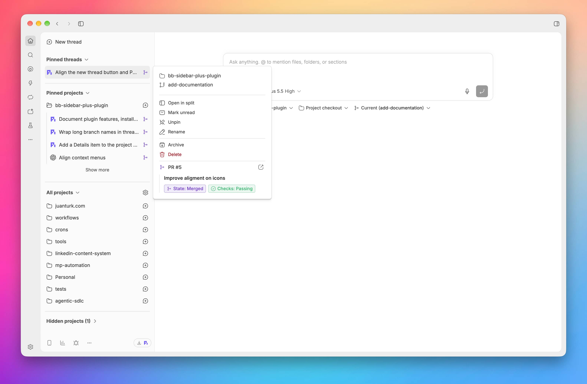
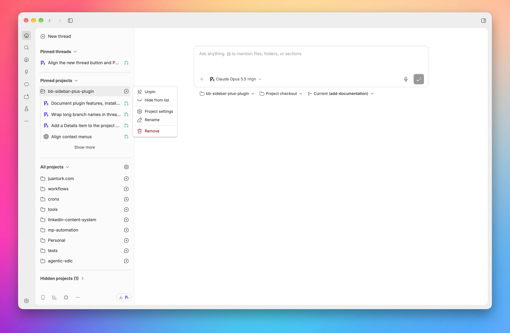
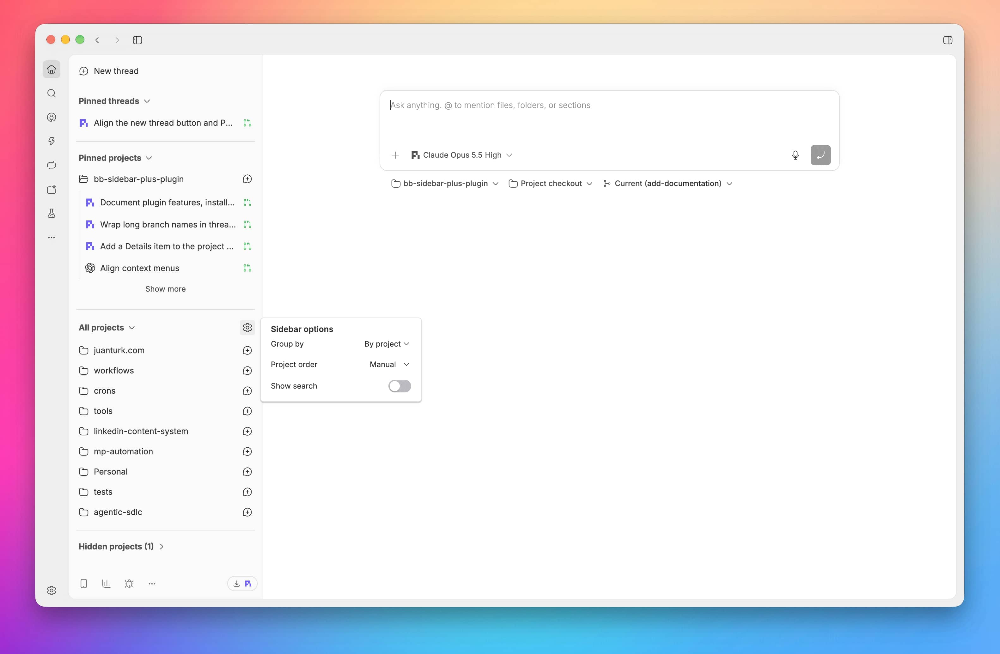
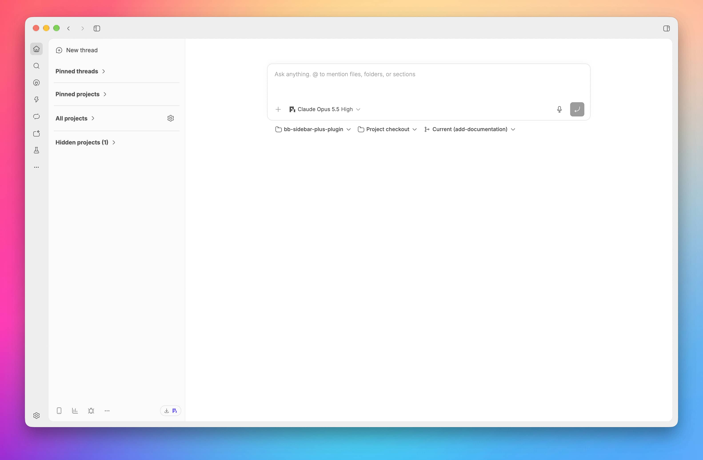

# Sidebar Plus Plugin

A [bb](https://getbb.app) plugin that enhances the sidebar thread list with a project-first view. Pin, hide, reorder, and search projects, and see each thread's status, branch, and pull request without opening it.






## Features

- Project-first sidebar with pinned, hidden, and collapsible sections
- Project search, grouping, and sorting
- Project pinning, hiding, reordering, and management
- Thread status and pull request indicators
- Thread details card with branch and pull request information
- Thread actions: open in split, mark read or unread, pin, rename, archive, and delete
- Preferences synced across bb windows

## Installation

Requirements: bb `>= 0.45` and plugin SDK `>= 0.6.15`.

Install from GitHub:

```sh
bb plugin install https://github.com/juanem1/bb-sidebar-plus-plugin
```

Or install from a local clone:

```sh
git clone https://github.com/juanem1/bb-sidebar-plus-plugin.git
cd bb-sidebar-plus-plugin
bb plugin install .
```

When you install a thread list plugin, bb switches to it automatically. If another thread list is active, select Sidebar Plus under **Settings → Appearance → Sidebar**, or from the CLI:

```sh
bb settings ui set sidebar.threadListProvider sidebar-plus/sidebar-plus
```

To go back to bb's default thread list:

```sh
bb settings ui reset sidebar.threadListProvider
```

To check the plugin or remove it:

```sh
bb plugin list
bb plugin remove sidebar-plus
```

## Development

### Setup

```sh
npm install
bb plugin install .   # install this checkout into bb as a local path plugin
```

### Live reload

```sh
bb plugin dev .
```

To reload the plugin by hand:

```sh
bb plugin reload sidebar-plus
bb plugin logs sidebar-plus # read server logs
```

## License

[MIT](LICENSE)
